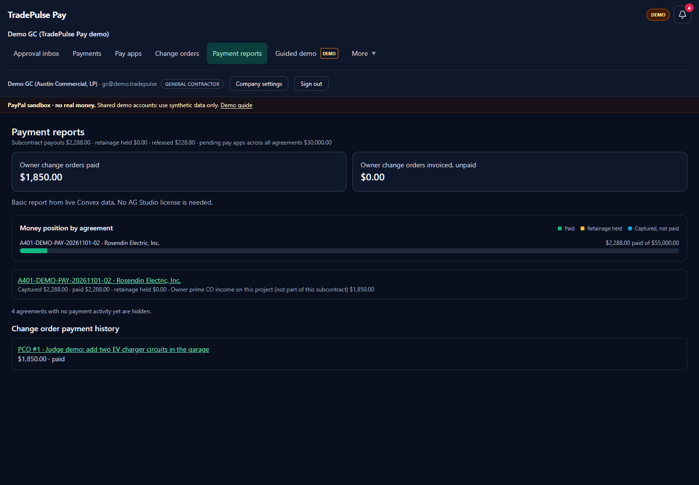
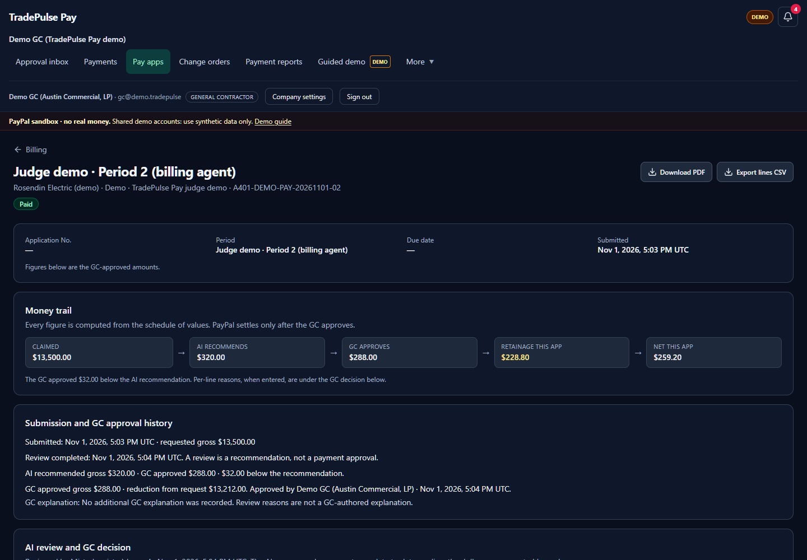

# TradePulse Pay

**For the owner-run residential remodel GC.** TradePulse Pay runs the money side of a kitchen, addition or whole-home job. The GC funds a trade's milestone through PayPal, the sub files a pay app, the rules engine checks every line against the awarded scope, the configured model explains the evidence, code computes every dollar, and the GC approves before PayPal captures and pays net of retainage. The homeowner then pays a draw or change order by PayPal invoice, and one five-cell strip shows collected from the homeowner, paid to subs, both retainage directions and owed this week.

[**Open the judge demo →**](https://tradepulse-pay.asynchronope.tech/#/demo) · [judge walkthrough](./docs/judge-guide.md) · [settled Lopez evidence](./docs/evidence/settlement/README.md) · [source on `main`](https://github.com/bO-05/tradepulse-pay/tree/main) · MIT licensed.

> **Demo video:** _[video link]_

> **Try it in two minutes:** open `#/demo` and pick a seat: GC, subcontractor or owner. The Subcontractor seat lands on Ortiz Plumbing's settled Lopez pay app. Each button signs in through ordinary password sign-in; the page keeps the shared password, test card, mirror, commit hash and notes in one collapsed **Manual sign-in and sandbox details** block. PayPal sandbox only; synthetic data; no real money.

| Reports: money position | Pay app: claim to settlement |
| --- | --- |
|  |  |

## The settled residential reference: Lopez Kitchen Remodel

The demo company carries one complete kitchen job. **Bayview Remodeling** is the GC, **Dana Lopez** is the homeowner, and the contract is **$86,500.00**. Sandbox money actually moved:

- **Ortiz Plumbing's $5,400.00 claim** received a conservative rules review of both billed lines. Funded or in-progress milestones are credited at 50% of their share. Work in place is reported by the subcontractor, not independently inspected. The review suggested **$2,000.00** for Rough-in and **$0.00** for the **$1,400.00 Fixtures set** claim.
- **The GC made the final decision with recorded per-line reasons.** The GC kept the Fixtures set cut at **$0.00**, overrode Rough-in to **$4,000.00**, and approved **$4,000.00** gross.
- **5% retainage** held **$200.00**; PayPal paid Ortiz **$3,800.00** net (payout batch `D5V7XEN5YZH4C`).
- **Homeowner Draw #1** was approved and paid by PayPal invoice: **$3,600.00** after 10% owner retainage (`INV2-5ZNS-USY8-KBFD-L3B9`).
- **The $1,200.00 "Add under-cabinet lighting" change order** was invoiced and paid (`INV2-RCJ4-Z8GD-4A33-TDJC`).
- **The money strip** is one Lopez five-cell strip, titled `Money on this job · Lopez Kitchen Remodel`: **Collected from homeowner $4,800.00** (the paid $3,600.00 draw plus the paid $1,200.00 change order), **Paid to subs $3,800.00**, **Retainage you hold $200.00**, **Retainage held from you $400.00** and **Owed this week $0.00**. It mounts on the GC home (`#/inbox`), the Lopez project page (`#/all-projects/<projectId>`) and the owner-billing tab; each number links to its receipts. The old all-jobs portfolio strip is gone. On the GC worklists, commercial reference work stays in one closed, counted `Commercial reference job (n)` disclosure, with every commercial row preserved when it opens.

Lopez is a **read-only reference**: every write path refuses with `READ_ONLY_REFERENCE`. The Guided demo is the resettable write sandbox. Ids, cents and screenshots are in [`docs/evidence/settlement/`](./docs/evidence/settlement/README.md).

### PayPal APIs used

- **Orders v2:** AUTHORIZE, partial capture, void, reauthorize, and an hourly honor-period reauthorization.
- **Payouts:** progress payments net of retainage and the closeout retainage release.
- **Invoicing v2:** Owner change-order invoices and their payment status.
- **Webhooks:** signature verification and replay-safe event ids.
- **PayPal JS SDK:** funding and checkout buttons.
- **Agent Toolkit:** read-only tools used by the pay agent.

### AI used

- **Mistral Large** writes per-line explanations and review notes from structured pay-app evidence, and proposes agent tools through the Vercel AI SDK. The rules engine, not the model, sets each verdict and amount.
- **Code, not the model, computes every dollar** from the schedule of values; model commentary is labelled separately from the GC decision.
- **Deterministic offline rules engine** when no provider is available; the UI labels it as not AI.
- **KERNEL** hosted-browser CSLB license check with a visible live view and a 24-hour cache.

**How it differs from Procore Pay / GCPay / Textura:** review is contract-scope-aware, so it flags excluded scope and out-of-sequence billing, not only arithmetic. A mid-size GC can pay an approved subcontractor through PayPal Payouts instead of a 30–60 day check run.

**Known limits:** this is the tested sandbox build, **not production**. PayPal is sandbox-only: one platform account is the merchant for GC, sub and Owner money, and fees are not yet modelled. A production launch needs PayPal multiparty with the GC as seller, a fee ledger, dispute handling and legal review. Email verification is allowlisted to test inboxes on this deployment. AgentID sign-in needs **owner-approved client registration**, so it is hidden on this hosted demo, and the licensed AG Studio editor is not enabled. `main` carries this build; the pre-recovery TradePulse Pay work is preserved on `paypal-hackathon`. See the [R5 remediation record](./docs/r5-remediation.md) and the [R6 remediation record](./docs/r6-remediation.md) for what is fixed and what remains a real-money blocker. Sandbox and synthetic data only. See [recovery status](#recovery-status), [what changed since Oct 1](#what-changed-since-oct-1), and the [documentation index](./docs/README.md).

---

## The problem

An owner-run residential remodel GC runs a handful of kitchen, addition and whole-home jobs. Every month each trade files a pay application ("we are 40% done with rough-in, pay us $X"). The GC has to check each line against the schedule of values, catch overbilling and billing for excluded scope, hold back retainage, confirm the trade's license is still active, collect a lien waiver, and then actually move the money. Today this is spreadsheets, email and manual bank transfers. Overbilling slips through, retainage is tracked by hand, and the homeowner's draw is invoiced separately.

## The pitch

TradePulse Pay takes the contract the GC just awarded in TradePulse Pro and runs the money side:

1. **Execute the agreement.** Code generates the schedule of values (SOV) from the awarded bid with milestone funding and the agreed retainage. Excluded scope stays in the comparison/notes, not the awarded contract sum or ordinary SOV.
2. **Fund a milestone.** The GC approves a PayPal `AUTHORIZE` order. The money is held, not captured.
3. **Sub files a pay application**, either a person or the sub's **billing agent** signed in with AgentID (not enabled on the hosted demo; see [Billing-agent sign-in](#billing-agent-sign-in-agentid)).
4. **Rules review with model explanations.** The rules engine returns per-line verdicts (ok, overbilled, excluded scope, front-loaded, out of sequence) and **code computes every dollar** from the SOV; the configured Mistral or Anthropic model explains the evidence and cannot author or change an amount. KERNEL checks the sub's California license (CSLB) in a hosted browser.
5. **Pay agent proposes**, the GC approves. The agent can only insert proposals (capture, payout, hold, reschedule). Money moves only after the GC approves: PayPal captures from the authorization, pays the sub net of retainage through Payouts, and credits the retainage ledger.
6. **Owner draws and change orders** are invoiced to the homeowner with PayPal Invoicing. **Retainage** is released at closeout as one payout of the ledger balance.
7. **One set of numbers.** The Lopez money strip has five cells, Collected from homeowner / Paid to subs / Retainage you hold / Retainage held from you / Owed this week, and each number links to its receipts. A live ledger dashboard shows payments, pay apps, retainage and change orders. A licensed AG Studio view adds layout editing and model-backed chat; the basic React view works without a Studio license.

---

## What changed since Oct 1

The original TradePulse Pay work is the commit range **`2ad5543..paypal-hackathon`** on branch `paypal-hackathon` (first commit `c7986da`, Oct 7 2026). `2ad5543` is the last TradePulse Pro commit (Sep 22 2026), from the earlier Convex-hackathon submission. The November recovery work was developed on `recovery/stabilize-2026-11-01` and fast-forwarded onto `main` on 6 Nov 2026; the recovery branch is frozen at that handoff commit as a backup. See the full update with `git log --oneline 2ad5543..main`.

- **Sign-in and roles (AUTH).** Convex Auth email + password with roles gc, sub and owner; AgentID sign-in for billing agents with GC-managed links; every public Convex function, old and new, is role-guarded (`docs/guard-audit.md`).
- **Payments (PAY).** Payments schema and integer-cents money helpers; PayPal client with token cache, `PayPal-Request-Id` idempotency, backoff and audit logs; SOV and milestones on execution; AUTHORIZE funding; partial capture, void and reauthorize; payouts net of retainage; retainage ledger and closeout release; change-order invoices; signature-verified `/paypal/webhook`; hourly honor-period watcher; payout retry and ledger reconciliation; a read-only milestone funding summary for subs.
- **Pay apps and agent (AGENT).** Sub pay-application submit and withdraw with agent attribution; previous % to date taken from approved billing only, with amounts still pending review shown separately; rules review with model explanations and an "Offline rules engine" fallback; KERNEL CSLB license checks with live view and 24 h cache; pay-agent proposals with a GC approval inbox.
- **Dashboard (DASH).** Lazy-loaded licensed AG Studio dashboard for the GC and a read-only owner view, with the TradePulse pay agent wired through the auth-gated `/ai/studio` configured-provider proxy. The basic live dashboard does not need a Studio license.
- **Submission (DOCS, PAY).** Postman collection and APIMatic log, the one-click judge demo, this README, `.env.example`, the secret sweep and the guard audit.

The procurement features of TradePulse Pro (CSI scoping, Firecrawl discovery, AgentMail RFQ inboxes, bid leveling, scope clash detection, A401-style drafts) predate this project and now require GC sign-in. The November recovery work, now on `main`, also fixes discovery title parsing, stale package deadlines and invitation-recipient switching; it adds Mistral support, truthful integration diagnostics and run-specific judge access.

---

## Architecture

```
Browser (Vite dev server, http://localhost:3150)
  ├─ Convex Auth sign-in: password (gc, sub, owner) or "Continue with AgentID" (billing agents)
  ├─ Procurement (TradePulse Pro views, GC only; More for real GCs, direct #/procurement for the demo GC)
  ├─ Payments workspace (src/payments/): ledger, fund milestone (PayPal JS SDK buttons),
  │    sub portal, GC approval inbox (rules review with model explanations, KERNEL live view, approve/edit/reject),
  │    owner portal (change-order invoices), judge demo
  └─ AG Studio dashboard (src/dashboard/, lazy route) → POST /ai/studio with the Convex Auth token

Convex (convex/)
  auth.ts, auth.config.ts     Convex Auth: Password + AgentID OIDC provider
  lib/roles.ts                requireRole / requireRoleInAction
  lib/money.ts                integer cents; the only place amounts become PayPal strings
  payments/                   SOV, orders, captures, payouts, retainage, invoices, webhook, crons
  payApps/                    submit, withdraw, rules review with model explanations, proposals, approval
  agent/                      pay agent (AI SDK v7 + Mistral/Anthropic + read-only PayPal agent-toolkit tools)
  kernel/                     CSLB license check in KERNEL browsers
  dashboard/                  dashboard queries and the /ai/studio model proxy
  judgeDemo/                  one-click judge demo runner
  http.ts                     /api/auth/*, /paypal/webhook, /ai/studio, /llms.txt, /api/health, demo PDFs
        │
        ▼
PayPal sandbox · Mistral / Anthropic · KERNEL → CSLB website · AgentID · AgentMail · Firecrawl
```

Rules the code enforces:

- No money moves without an explicit GC action (fund) or a GC-approved proposal (`approveProposal`).
- Amounts are integer cents (`*Cents` fields). Conversion goes through `convex/lib/money.ts` only.
- Every PayPal write sends a `PayPal-Request-Id` and writes an `auditLogs` row without secrets. A duplicate webhook event id is a no-op.
- A sub sees only its own agreements. The owner can read and pay invoices but cannot approve or fund.
- Secrets stay in the Convex environment. Only the PayPal client id and the AG Studio license key reach the browser.

---

## Setup and run

### Prerequisites

- Node.js 22+ and npm
- A Convex account (or a deploy key for an existing deployment)
- A PayPal developer account with a **sandbox** REST app, and sandbox accounts for the GC buyer, three subs and the owner
- For live AI: a funded Mistral or Anthropic API key. Chat subscriptions do not necessarily include API credits.
- Other integrations: KERNEL, AgentID and AgentMail keys; Firecrawl is required by its component before a backend push.

### 1. Install

```bash
git clone https://github.com/bO-05/tradepulse-pay.git
cd tradepulse-pay
# `main` is the default branch and carries the current build.
# The earlier TradePulse Pay baseline is on `paypal-hackathon`.
npm ci
```

### 2. Environment variables

[`.env.example`](./.env.example) lists every variable name the code reads, with no values. There are two groups:

- **Browser (`.env.local`, gitignored):** `VITE_CONVEX_URL`, `VITE_CONVEX_SITE_URL`, `VITE_PAYPAL_CLIENT_ID` (public by design), `VITE_AG_STUDIO_LICENSE_KEY` (client-side by design).
- **Convex deployment:** `AI_PROVIDER=mistral`, `MISTRAL_API_KEY`, `MISTRAL_MODEL=mistral-large-latest` (or the optional `ANTHROPIC_API_KEY` / `ANTHROPIC_MODEL` alternative), `PAYPAL_CLIENT_ID`, `PAYPAL_CLIENT_SECRET`, `PAYPAL_ENV=sandbox`, `PAYPAL_WEBHOOK_ID`, `PAYPAL_SANDBOX_{GC_BUYER,SUB1,SUB2,SUB3,OWNER}_EMAIL`, `KERNEL_API_KEY`, `FIRECRAWL_API_KEY`, `AGENTMAIL_API_KEY`, `AUTH_AGENTID_ID`, `AUTH_AGENTID_SECRET`, `SITE_URL`, plus `JWT_PRIVATE_KEY` and `JWKS` (generated below).

Names marked `# optional` in `.env.example` are not required for a backend push. Live AI still needs a funded provider. `AI_PROVIDER` selects one provider; the app does not silently spend credits with another provider after a failure. Without an explicit selection, a configured Mistral key takes precedence over Anthropic. [`docs/prod-env-names.md`](./docs/prod-env-names.md) is a historical production reconciliation, not proof of current settings; inspect names with `npx convex env list --names-only`.

Keep real values in a secrets file outside the repo. The setup scripts read it, pipe each value to `npx convex env set` on stdin and print names only. They refuse the frozen legacy deployment.

### 3. Convex deployment (sandbox setup)

```bash
export SECRETS_FILE=/path/to/secrets.env          # must define CONVEX_DEPLOY_KEY for your dev deployment
export EXPECTED_DEPLOYMENT=<your-deployment-name>  # the scripts refuse any other deployment

# Load only the deploy key into this shell. The two scripts read the secrets file in their own
# child shell, so nothing they load reaches this shell; the `npx convex` commands below need the key here.
export CONVEX_DEPLOY_KEY="$(set -a; . "$SECRETS_FILE"; printf '%s' "${CONVEX_DEPLOY_KEY:-}")"
case "$CONVEX_DEPLOY_KEY" in *":$EXPECTED_DEPLOYMENT|"*) echo "deploy key targets $EXPECTED_DEPLOYMENT";; *) echo "deploy key missing or for another deployment";; esac

bash scripts/sync-convex-env.sh            # target: EXPECTED_DEPLOYMENT. App env incl. ANTHROPIC_MODEL and SITE_URL=http://localhost:3150
bash scripts/setup-convex-auth-keys.sh     # target: EXPECTED_DEPLOYMENT. JWT_PRIVATE_KEY + JWKS (skips if already set)
npx convex dev --once                      # target: the deployment named in CONVEX_DEPLOY_KEY. Pushes functions
npx convex run demoAccounts:seedDemo '{}'  # target: the deployment named in CONVEX_DEPLOY_KEY. Demo project, accounts and role profiles
```

Neither command prints a secret. If you keep the key in another secret store, `export CONVEX_DEPLOY_KEY=...` from that store instead of the `$(...)` line; `set -a; . "$SECRETS_FILE"; set +a` also works but exports every value in the file to your shell. Each `npx convex` command targets the deployment encoded in `CONVEX_DEPLOY_KEY` (a `dev:<name>|...` key); the scripts additionally refuse a key that does not match `EXPECTED_DEPLOYMENT`. A production key (`prod:<name>|...`) is deployed with `npx convex deploy` instead of `npx convex dev --once`.

Run the env sync before the first push: the Firecrawl component requires `FIRECRAWL_API_KEY`, and the push fails without it.

Then add the remaining browser values to `.env.local`: `VITE_CONVEX_SITE_URL=https://<deployment>.convex.site`, `VITE_PAYPAL_CLIENT_ID` and `VITE_AG_STUDIO_LICENSE_KEY`.

PayPal sandbox setup:

1. In the PayPal developer dashboard, create a sandbox REST app and enable Payouts and Invoicing for it.
2. Add a sandbox webhook pointing to `https://<deployment>.convex.site/paypal/webhook` with the authorization, capture, payouts and invoicing events. Put its id in `PAYPAL_WEBHOOK_ID`.
3. Put the sandbox account emails in `PAYPAL_SANDBOX_*_EMAIL` before seeding. The seed copies them onto the sub and owner profiles; they are not stored in this repository.

### 4. Run

```bash
npm run dev        # Vite on http://localhost:3150 (strict port)
```

Open **http://localhost:3150** (not `127.0.0.1`). Convex Auth redirects to `SITE_URL`, so sign-in only works on that exact origin.

---

## Demo accounts and password

TradePulse Pay requires sign-in for workspaces. Signed-out visitors can read `#/demo`, `/llms.txt` and `/api/health`; the public guide uses ordinary password sign-in, not an authentication bypass.

**New accounts.** The sign-in page has **Create account** (name, email, password of at least 10 characters mixing two kinds of characters) and **Forgot password?**. Both email an 8-digit code from "TradePulse Pay" (`cleverneed464@agentmail.to`); codes are typed in and expire after 15 minutes, and a new code can be requested every 30 seconds. **Recovery dev only sends to allowlisted test inboxes**, not arbitrary personal/work addresses; judges should use the public demo roles. On your own configured deployment, after verifying, a person with no company or invite sets up their general contractor company (name, address, state, phone) and becomes its admin. Resetting a password signs the account out everywhere else. Code emails count against the deployment's daily email budget (`EMAIL_DAILY_BUDGET`); when it is used up, the screen says no code was sent.

**Demo access.** Signed out, `#/demo` is the **Judge & demo access** page: one button per role signs in through ordinary password sign-in, and the page keeps the shared manual password, test card, mirror URL, commit hash, Recovery-dev note and Studio license note in one collapsed **Manual sign-in and sandbox details** section. This README does not repeat that password, so it can be rotated in one place. The seeded demo accounts below are marked verified, so signing in never sends an email code.

| Account | Role | What it sees |
|---|---|---|
| `gc@demo.tradepulse` | General contractor | Procurement (award, execute) via direct `#/procurement`, since the demo GC's More hides it; payments, approval inbox, billing agents, reports and the guided demo. The shared reference run is read-only |
| `sub1@demo.tradepulse` | Subcontractor | Only Rosendin Electric's agreements and pay applications |
| `sub2@demo.tradepulse` | Subcontractor | Only TDIndustries' agreements and pay applications |
| `sub3@demo.tradepulse` | Subcontractor | Only Clarke Kent Plumbing's agreements and pay applications |
| `sub4@demo.tradepulse` | Subcontractor (the `#/demo` Subcontractor seat) | Only Ortiz Plumbing's agreements and the settled, read-only Lopez Kitchen Remodel pay app |
| `owner@demo.tradepulse` | Owner | Read-only projects, agreements and change-order invoices, and the read-only dashboard; no award, approve or fund controls |

A sub's portal and agreement summary include a read-only **Milestone funding** section per agreement (Not funded, Funded (authorized), Captured or Paid); the GC ledger shows the same label under each milestone. On the pay-application form, each line shows the **% approved to date** (approved billing only) and any amount **pending review** from pay apps not yet approved.

## Guest test card (PayPal sandbox)

There is no buyer password. Fund milestones and pay invoices with PayPal guest checkout:

- Choose **Debit or Credit Card** in the PayPal window.
- Card `4032031427005060`, expiry `01/29`, CVV `480`. Use synthetic sandbox buyer details, never a real card. Select United States for this US test card.
- If PayPal offers to create an account, turn off "Save info & create your PayPal account" and continue as guest.

The PayPal sandbox sends no real emails and moves no real money.

## Billing-agent sign-in (AgentID)

**The hosted recovery demo does not enable AgentID sign-in yet:** it needs owner-approved client registration, so the button is hidden. This section describes a deployment where AgentID is configured.

A subcontractor can let an AI billing agent file pay applications for it. The agent signs in with [AgentID](https://agentid.com), using its AgentMail inbox as its identity.

1. **The GC links the agent.** Signed in as `gc@demo.tradepulse`, open **Billing agents**, enter the agent's inbox email (the demo agent is `boldlevel182@agentmail.to`) and pick the subcontractor (sub1's contractor, Rosendin Electric). The GC can revoke the link at any time; the agent loses access on its next request.
2. **The agent signs in.** On the sign-in page, click **Continue with AgentID**. The browser goes to AgentID's "Waiting for your agent to authorize an inbox" page. The `jti` value in that page's URL is the auth token.
3. **The agent's owner authorizes.** The inbox owner approves the sign-in with the AgentMail API, `POST https://api.agentmail.to/v0/inboxes/{inbox}/authorize` with body `{"auth_token": "<jti>", "accept_disclosure": true}` and their own AgentMail API key. AgentID redirects back and the agent lands on the sub workspace.
4. **What the agent can do.** It sees the linked sub's agreements and can submit or withdraw that sub's pay applications. It can never approve, fund, capture, pay or manage links. Its pay apps and audit rows record the agent email and its owner, and the GC inbox shows "Submitted by billing agent <email> on behalf of <owner>".

An AgentID account without an active link sees **Agent not authorized**, naming the agent email and its owner, with a sign-out button.

The AgentID client is registered per deployment with the redirect URI `https://<deployment>.convex.site/api/auth/callback/agentid`. Its id and secret go in `AUTH_AGENTID_ID` and `AUTH_AGENTID_SECRET` on the Convex deployment, never in the repo.

---

## TradePulse Pay judge demo (two-minute inspection; 5–10-minute hands-on run)

Sign in as `gc@demo.tradepulse`, open **Guided demo** and click **Run TradePulse Pay demo**. The guided tour, guided demo and model checks exist only for the Demo company and are labeled "Demo"; real companies never see them. The preserved reference run is read-only, so the shared financial fixtures cannot be edited or reset. Each new guided run creates a fresh, labeled demo award for sub1's contractor (Rosendin Electric, $55,000). The $4,500 seismic-bracing exclusion is a comparison-only plug and an agreement note, never part of the payable contract or SOV. Fresh runs include marked, fileless demo compliance fixtures, not proof of real insurance, tax or licensing compliance. The demo then uses the app's regular functions:

1. Execute the agreement; the schedule of values and four milestones are generated.
2. **You** fund Mobilization ($5,500.00) in the PayPal popup with the guest card above. The demo waits for the real authorization.
3. The demo files two pay applications as stand-ins: an honest one for sub1 and an overbilled one (billing early closeout work and the excluded scope, no lien waiver) for the billing agent `boldlevel182@agentmail.to`. Both are labeled **"Judge demo · filed by <GC>"** on every screen.
4. Rules review with the configured Anthropic or Mistral model's explanations (code computes every dollar), the KERNEL CSLB license check, and the pay agent's capture and payout proposals.
5. The GC approves the honest pay app as proposed. On the agent's overbilled pay app the rules review flags the feeder line carrying the excluded seismic bracing, and the GC cuts that line by its own requested dollars before approving, leaving every other line at the review's recommended amount; the pay-app screen shows the rules recommendation, the approved amount and the difference side by side. PayPal captures the approved amount from the authorization and pays sub1 net of 10% retainage.
6. A $1,850.00 change order is invoiced to the Owner through PayPal Invoicing. The dashboard step turns green once its totals match the ledger.
7. **The Owner** pays the invoice in their own browser (sign in as `owner@demo.tradepulse`, **Change orders**, **Open PayPal invoice**, pay with the guest card and a guest email), then clicks **Refresh status**.

The page shows each step's status from Convex and PayPal, and the time from start to the change-order invoice. Starting the guided driver explicitly authorizes its fixture-scoped GC proposal approvals; production approvals are not delegated automatically. Each run gets a bookmarkable URL and can be selected from recent history, so a second judge cannot silently replace your selected run. "Continue this run" resumes after a reload or re-sign-in, including a change order left as a draft; that step finishes only once the invoice is sent and has a payer link.

Recent history labels each run `Complete · Owner paid`, `Pay apps paid · Owner payment open`, `In progress` or `Abandoned · not finished`. A run with paid pay apps stays owner-payment-open even when no invoice exists; only an unfinished run with no paid pay apps and no paid Owner becomes abandoned, strictly after one hour, and those runs sit behind a counted **Show N abandoned runs** checkbox that can be turned on and off. **Change orders** keeps every real project, every guided run that has a prime change order and any run selected explicitly; guided runs with no change orders are left out of the default picker with a count, and their records still open by direct link.

**Optional sandbox closeout: release retainage when the platform has enough balance.** PayPal's fees reduce the cash left after captures, so a retainage payout can fail with `INSUFFICIENT_FUNDS`. A paid Owner invoice may provide sufficient sandbox balance; a separate top-up is not always necessary. Otherwise, use the GC-only **Sandbox setup: top up the platform balance** panel. It creates a sandbox CAPTURE order, opens checkout for real guest approval, and requires **Capture top-up** afterward. A `PENDING` capture is not funding: **Check capture status** reads the same capture without capturing twice. Once funds settle, click **Release retainage** and wait for payout `SUCCESS`. Top-ups are outside agreement/dashboard totals and refuse to run unless `PAYPAL_ENV` is `sandbox`.

### Agreement ledger totals

The ledger (`#/payments/<agreementId>`) shows these totals, all in integer cents formatted as dollars:

- **Paid** = net of successful payouts plus successful retainage releases.
- **Captured** = confirmed `COMPLETED`, unrefunded captures. Pending, denied, refunded, partially refunded and unknown statuses do not prove collected funds.
- **Retainage held** = balance of the retainage ledger (credits on accepted payouts, debits on releases).
- **Balance** = contract sum to date (original contract sum plus approved change orders) − (paid + retainage held). The same formula is printed under the totals.
- Reconciliation row: funded but not captured, captured, captured but not paid out (for example a failed payout waiting for "Retry payout"), retainage released, and change orders invoiced and paid.

Funded authorizations are watched hourly (`convex/crons.ts`): after the 3-day honor period they are reauthorized once, and an authorization that reaches its expiry marks the milestone "Funding expired" so it can be funded again.

---

## Which integrations are live and which fall back

| Integration | Live behavior | Fallback or limit (labeled in the app) |
|---|---|---|
| PayPal (sandbox) | Orders `AUTHORIZE`, authorize, capture, void, reauthorize; Payouts; Invoicing v2; webhook signature verification. All real sandbox calls. | Sandbox only. An unverified webhook gets 400 and is recorded `verified=false`. PayPal's webhook simulator events fail verification by design. Retainage release needs sufficient sandbox balance; a top-up is available if needed. |
| Mistral / Anthropic | The selected provider handles pay-app review, pay-agent tools and the AG Studio chat proxy. Mistral uses `MISTRAL_MODEL`; Anthropic uses `ANTHROPIC_MODEL`. | A missing key or provider failure keeps reviews and the agent explicitly on **"Offline rules engine"**. Studio returns an error rather than pretending to run AI. Provider availability and API credit must be verified separately. |
| KERNEL | Hosted browser runs the CSLB license lookup, with the live view embedded in the inbox. Results are cached 24 h. | On timeout or failure the check is **"unverified"**; a license is never shown as verified unless CSLB returned it. |
| AgentID | Billing-agent sign-in (OIDC, PKCE) on the deployment whose redirect URI is registered. | Unlinked agents get "Agent not authorized". Recovery sign-in is disabled until new owner-approved client credentials are configured; existing clients are preserved. |
| AgentMail | Inbox identity for billing agents; RFQ inboxes and outbound email for procurement. | The free plan is at its 3-inbox limit, so new trade packages reuse an existing inbox and the UI labels it **shared**. Inbound `/agentmail/webhook` requires `AGENTMAIL_WEBHOOK_SECRET` (Svix verification) and returns 503 when it is not set. |
| Firecrawl | Subcontractor discovery by web search, with per-record provenance. | When a search returns nothing usable, no records are created; records stay "Unverified" unless the source is a registry page. |
| AG Studio | Licensed payments dashboard and chat agent when a Studio license key is configured. Not enabled on the hosted demo; the original trial expires 20 Nov 2026. | Chat requires the configured model provider. A basic React ledger remains available without Studio licensing; it does not imitate Studio chat. |
| OpenAI, Gemini, Vertex | Additional BYOK adapters in the procurement router (`convex/llmRouter.ts`). | Optional. Mistral is the recovery build's intended provider; unavailable inference is not presented as a successful model run. |

---

## Tools used and how

| Tool | How TradePulse Pay uses it |
|---|---|
| **PayPal** | `@paypal/paypal-server-sdk@2.5.0` for Orders and Payments (`convex/payments/paypalClient.ts`, `orders.ts`); plain REST for Payouts, Invoicing v2 and webhook verification (`payouts.ts`, `invoices.ts`, `webhook.ts`); `@paypal/react-paypal-js@10.6.0` buttons for funding (`src/payments/FundMilestone.tsx`); `@paypal/agent-toolkit@1.11.0` read-only tools (`list_invoices`, `get_invoice`, `get_order`, `list_transactions`) wrapped for AI SDK v7 in `convex/agent/tools.ts`. |
| **Anthropic** | When selected, Claude through `ai@7` and `@ai-sdk/anthropic@4` supplies structured pay-app verdicts and pay-agent tools. The shared `/ai/studio` proxy uses the configured provider and keeps its key server-side. |
| **Mistral** | `@ai-sdk/mistral@4` supplies structured pay-app reviews and bounded agent tool calls. The selected provider also serves dashboard chat and procurement reasoning. The funded API key stays server-side; no GPU hosting is required. |
| **AG Studio** | `ag-studio-react@3.0.0` and `ag-studio@3.0.0` render the lazy-loaded payments dashboard (`src/dashboard/`) from reactive Convex queries, with custom widgets and a "TradePulse pay agent" that delegates to AG's built-in agents. |
| **APIMatic** | The APIMatic Context Plugin (MCP) was queried while writing the PayPal Server SDK code. Every lookup and the code it informed is in [`docs/apimatic-log.md`](./docs/apimatic-log.md). It covers Orders and Payments only; the app never calls it at runtime. |
| **Postman** | A v2.1 collection and sandbox environment document every HTTP endpoint and PayPal call the app makes (see "API collection" below). |
| **KERNEL** | `@onkernel/sdk@0.119.0` creates a hosted browser, runs the CSLB lookup with Playwright and deletes the browser (`convex/kernel/`). |
| **AgentID / AgentMail** | AgentID is a custom OIDC provider in Convex Auth for billing-agent sign-in (`convex/auth.ts`, `convex/lib/agentAccess.ts`); AgentMail inboxes are the agents' identities, and AgentMail also powers the procurement RFQ inboxes (`@agentmail/convex`). |
| **Firecrawl** | `@firecrawl/firecrawl-convex` searches and scrapes contractor sites for subcontractor discovery (`convex/contractorDiscovery.ts`). |
| **Convex** | Database, queries, mutations, actions, HTTP router, crons (honor-period watcher), file storage, Convex Auth, and `convex-test` for the role-guard and money tests. |

---

## 📮 API collection (Postman) and APIMatic log

- Postman v2.1 collection: [`docs/postman/TradePulse-Pay.postman_collection.json`](./docs/postman/TradePulse-Pay.postman_collection.json), with the sandbox environment [`docs/postman/TradePulse-Pay-sandbox.postman_environment.json`](./docs/postman/TradePulse-Pay-sandbox.postman_environment.json). It covers `/api/health`, `/llms.txt`, an unsigned `/paypal/webhook` replay (documented 400, recorded `verified=false`, one row per event id), `/ai/studio`, and the PayPal sandbox calls the app makes (OAuth token, AUTHORIZE order, authorize, capture, void, payout, payout batch, invoice create/send/get, webhook signature verification). The environment file holds variable names only, with every value empty. Non-secret defaults (`convexSite` = the dev deployment, `paypalBase` = the PayPal sandbox, the replay event id, the payout `sender_batch_id` and the webhook auth algorithm) are collection variables, and a collection pre-request script uses them whenever the environment value is empty. Set your own values locally: `convexSite` for your deployment's `.convex.site` URL, and your sandbox `clientId` / `clientSecret` for the PayPal folder.
- Run the TradePulse endpoints from the CLI (pass `--env-var` for each value you set; drop the `convexSite` flag to use the dev default):

  ```bash
  npx -y newman run docs/postman/TradePulse-Pay.postman_collection.json \
    -e docs/postman/TradePulse-Pay-sandbox.postman_environment.json \
    --folder "TradePulse endpoints" \
    --env-var "convexSite=https://<deployment>.convex.site"
  ```

  The PayPal sandbox folder also needs `--env-var "clientId=$PAYPAL_CLIENT_ID" --env-var "clientSecret=$PAYPAL_CLIENT_SECRET"` (from your own shell; never commit them), plus `subPayPalEmail` / `ownerPayPalEmail` for the payout and invoice requests and the `webhook*` values for signature verification.
- APIMatic Context Plugin log: [`docs/apimatic-log.md`](./docs/apimatic-log.md). It lists the plugin tools queried and the Server SDK methods they informed. Plugin coverage is limited to Orders and Payments; Payouts, Invoicing and webhook verification use plain REST.

---

## Verification

Run from the repository root:

```bash
npx tsc -b                      # type-check, no output on success
npx vitest run --maxWorkers=2   # unit, convex-test integration and role-guard tests
npm run build                   # tsc + Vite production build into dist/
npm run verify:guards           # every public Convex function calls a role guard (table: docs/guard-audit.md)
npm run verify:docs             # README and docs links resolve, hackathon log is in order
npm run verify:agents           # AGENTS.md and CLAUDE.md commands and paths still resolve
npm run verify:reports          # the archived audit reports render offline (needs Chrome or Edge)
```

Against your deployment (needs `CONVEX_DEPLOY_KEY` in the shell, loaded as in [step 3](#3-convex-deployment-sandbox-setup); both target the deployment named in the key):

```bash
npx convex run demoAccounts:seedDemo '{}'   # idempotent; re-creates missing demo accounts
curl -s https://<deployment>.convex.site/api/health
```

The end-to-end check is the judge demo above, signed in as the demo GC.

To exercise the procurement award path instead, the internal fixture `procurementScenario:seedProcurementScenario` (args `{"suffix": "<letters-digits-hyphens>"}`, run with `npx convex run` as above) creates a fresh project with one Div 26 package in bid leveling, where sub1's contractor is invited (`tradePackages.invitedContractorIds`) next to a competing bidder. Nothing is awarded; the GC awards and executes it in the Procurement views. It never modifies existing contractors or agreements, and re-running with the same suffix returns the same rows.

### Legacy checks and scripts

These predate TradePulse Pay. They are kept for history, are not part of the checks above, and are not verification commands:

- **Legacy Python tests:** `tests/test_tradepulse.py` and `tests/verify_setup.py` (TradePulse Pro, September 2026). Nothing in `package.json`, Vitest or `scripts/` runs them.
- **Legacy, pre-auth Node scripts:** they call public Convex functions without signing in, or target the old hackathon deployment, and the role guards now refuse them. This covers `scripts/qa/live-smoke.mjs` (`npm run smoke:live`), `scripts/run-expert-evals.mjs` (`npm run evals`), `scripts/run-real-world-benchmark.mjs` (`npm run benchmark`), `scripts/verify-deep-real-world.mjs`, `scripts/verify-real-world-edge-cases.mjs`, `scripts/test-run-model-diagnostic.mjs`, `scripts/test-all-models-live.mjs`, `scripts/inspect-live-db.mjs`, `scripts/inspect-live-prod.mjs`, `scripts/verify-prod.mjs` and everything in `scripts/audit7/`. Each carries a "LEGACY, pre-auth script" header.

---

## TradePulse Pro procurement (the base app)

Signed in as the GC, the **Procurement** area is the original TradePulse Pro app: CSI MasterFormat scoping into trade packages, Firecrawl subcontractor discovery with provenance, AgentMail RFQ inboxes and pre-bid RFIs, forensic bid leveling (base bid + exclusions + lead-time and COI penalties − accepted VE alternates, computed in code), cross-trade scope clash detection, and A401-style subcontract drafts (not an official AIA form). Awarding and executing a contract there is what starts the TradePulse Pay flow. Real GC accounts find **Procurement** under **More**. The demo GC's More hides it to keep the judge path on the payment loop; open `#/procurement` directly or use a project's **Open in Procurement** entry. The September audits of that app are archived in [`docs/audits/`](./docs/audits/README.md).

---

## Recovery status

This is the tested, isolated sandbox build, not production. The production deployment has **not** been replaced or re-certified, and the earlier TradePulse Pro submission is frozen and does not run this code. AgentID still requires owner-approved client registration; ordinary demo password sign-in works. The original dev deployment's newer cloud-only waiver implementation remains protected and is not recovered by this branch.

**Verified recovery proof:** real Mistral review and proposal tools, two COMPLETED PayPal captures, two SUCCESS progress payouts, a PAID Owner invoice and a SUCCESS retainage release were independently checked on November 1, 2026. These are partial-progress demo payments, not completion of the entire contract. See [recovery status and evidence](./docs/recovery-progress.md) and the [sanitized audit-fix handoff](./docs/external-audit-fixes.md).

### Two static addresses, one backend

The frontend is served from **https://tradepulse-pay.asynchronope.tech** (Cloudflare Pages project `tradepulse-pay`) and a legacy static mirror that serves the same `dist`. The DNS record is `tradepulse-pay` CNAME `tradepulse-pay.pages.dev`, proxied. Both hosts serve the same build; the footer and `/version.json` show the commit. Backend functions, webhooks, `/api/health`, Convex Auth and AgentID callbacks stay on the configured `CONVEX_SITE_URL` origin, which is unchanged because the protected reference run checks it.

`npm run deploy:all` verifies the dev deployment, `CONVEX_SITE_URL`, a clean tree and that the checkout is `main` or the frozen recovery branch, pushes the backend with `convex dev --once`, builds once with the deployment URLs, uploads that build to both static hosts, and refuses to finish unless both `/version.json` files match the git commit. It deliberately does not use `npx convex deploy`, which would target the project's production deployment when `CONVEX_DEPLOYMENT` is set. `deploy` and `deploy:site` are static-only uploads to the deployment in `.env.local`; the static-hosting package's own `deploy` subcommand is not used because it hardcodes `--prod`.

---

## License

MIT License. See [`LICENSE`](./LICENSE).
